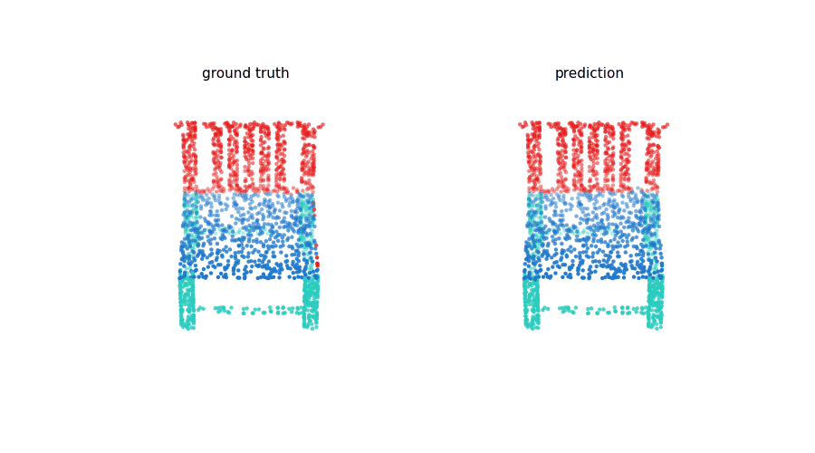
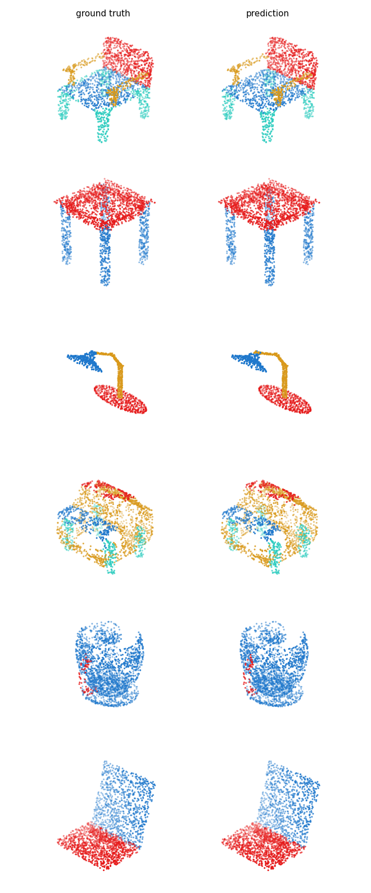

# Point Transformer, from scratch

A clean, from-scratch PyTorch reimplementation of [Point Transformer](https://arxiv.org/abs/2012.09164)
(Zhao et al., ICCV 2021) for **3D part segmentation** on ShapeNet-Part. Point Transformer replaces
the fixed max-pool that PointNet++ uses to aggregate each local neighborhood with **vector
self-attention**: each point's new feature is a learned, position-aware weighted blend of its
neighbors, with a separate weight per feature channel.

## Results (ShapeNet-Part, 2048 points)

| Model | Instance mIoU |
|---|---|
| **Point Transformer (vector attention)** | **85.5%** |

~4M parameters; trained for 100 epochs on a free Kaggle T4. The paper reports 86.6% with the full
training recipe, so this lands within about a point of it.

*Ground truth (left) vs prediction (right), each point colored by its part. The model separates
parts cleanly across categories, chair legs from seat from back, lamp shade from stem from base,
laptop screen from keyboard.*

## What's in the notebook

- **The Point Transformer layer** (vector self-attention + learned position encoding), built from
  scratch, with the paper's subtraction relation and per-channel attention weights.
- A full **U-Net**: an encoder of residual transformer blocks with transition-down stages, a
  decoder with transition-up (interpolation + skip connections) back to full resolution.
- Farthest point sampling, kNN grouping, instance-mIoU evaluation, training curves, and spinning
  part-segmentation GIFs.

## Run it

1. Click **Open in Colab** above (the notebook also auto-detects Kaggle and local runs).
2. **Runtime > Change runtime type > GPU.**
3. Run top to bottom. The first run pulls ShapeNet-Part from a Hugging Face mirror (Stanford's own
   server is usually down) and caches it. Training 100 epochs takes a few hours, so on Kaggle use
   **Save Version** for a background run.

## Key concepts

The interesting part of Point Transformer is not the layers, it is *why* attention beats pooling.

- **Attention is a set operator.** Self-attention is invariant to the order of its inputs, which
  is exactly what a point cloud needs (shuffle the points, same shape). It is a more natural fit
  for point clouds than for language or images, where order actually carries meaning.
- **Vector attention, not scalar.** A standard transformer gives each neighbor one attention
  weight (a scalar from a dot product). Point Transformer gives each neighbor a whole *vector* of
  weights, one per feature channel, so a neighbor can inform one feature strongly and another
  barely. This single change is worth ~6 mIoU over scalar attention in the paper.
- **Local, not global.** Attention runs only over each point's 16 nearest neighbors, not the whole
  cloud. Global attention would be quadratic and hopeless on a million-point scene; local
  attention is linear and scales.
- **Position encoding earns its keep.** The relative position of each neighbor is fed through a
  small MLP and added into both the attention weights and the values. Without it, accuracy drops
  sharply, the network needs to know *where* a neighbor sits, not just what it looks like.
- **Same skeleton as PointNet++.** Farthest point sampling, kNN grouping, the downsample-then-
  upsample U-Net, are all inherited. The only genuinely new module is the attention layer that
  replaces the max-pool.

## Series

This continues my work through the 3D point-cloud stack, after a
[PointNet and PointNet++ repo](https://github.com/dushyantDevl/pointnet-family-pytorch). The
through-line: PointNet learns one global feature, PointNet++ adds hierarchical local neighborhoods
aggregated by max-pool, and Point Transformer keeps that skeleton but swaps the max-pool for
learned vector self-attention. This repo also adds the U-Net decoder for dense per-point
prediction (segmentation) rather than one label per shape.
